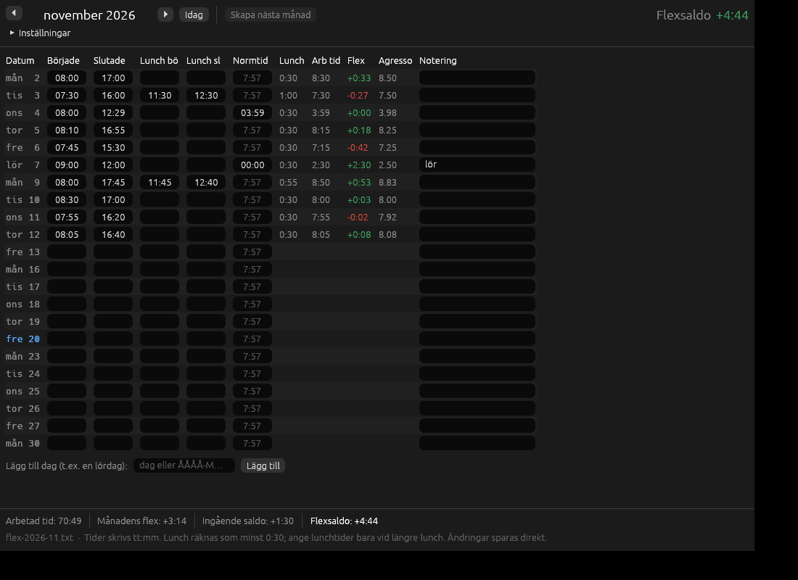

# Tardis – flextid

Ett Rust-program som räknar flextid med samma regler som Excel-mallen
"Mall beräkning flex". Det finns både ett grafiskt program (`tardis-gui`) och
ett terminalprogram (`tardis`). Båda använder samma månadsfiler,
`flex-ÅÅÅÅ-MM.txt`, som också går att redigera för hand.



## Bygga

```bash
cargo build --release
```

Programmen hamnar i `target/release/` (`tardis-gui` och `tardis`). Vill du bara
ha terminalprogrammet, utan GUI-beroenden: `cargo build --release --no-default-features`.

## Grafiskt gränssnitt

```bash
tardis-gui                 # använder mappen ~/Tardis
tardis-gui /sökväg/till/mapp
```

Mappen kan också anges med miljövariabeln `TARDIS_MAPP` eller ändras under
*Inställningar* i programmet.

* Bläddra mellan månader med pilarna, eller hoppa till aktuell månad med *Idag*.
* Skriv tider direkt i tabellen. Arbetad tid, flex och Agressotid räknas om
  medan du skriver och allt sparas direkt. Ogiltiga tider visas i rött och
  sparas inte.
* Normtid-kolumnen är tom när månadens normtid gäller; skriv t.ex. `3:59` för
  en dag med arbetstidsförkortning.
* *Skapa nästa månad* (eller *Skapa månaden* när du bläddrar till en månad som
  saknas) skapar månaden med föregående månads flexsaldo som ingående saldo.
* Har du ändrat i en tidigare månad visas en varning om att ingående saldo inte
  stämmer, med en knapp för att uppdatera det.
* *Lägg till dag* lägger till en helgdag, t.ex. en lördag du arbetat (normtid 0:00).
* Under *Inställningar* ändras ingående saldo, normtid, flexram och minsta lunch.

## Terminalprogram

```bash
tardis ny 2026-11 --saldo +1:30          # skapa månadsfil med ingående saldo
tardis in idag 08:00 17:00               # registrera dagen (lunch 30 min)
tardis in 2026-11-03 07:30 16:00 11:30 12:30   # med längre lunch
tardis in 2026-04-02 08:00 12:29 --normtid 3:59  # dag med arbetstidsförkortning
tardis rapport                           # tabell + flexsaldo för senaste månaden
tardis nästa                             # skapa nästa månad, saldot förs över
tardis dag 08:00 17:00                   # räkna ut en dag utan att spara
```

### Nästa månad skapas automatiskt

* `tardis nästa` skapar nästa månads fil från den senaste i mappen.
  Månadens flexsaldo blir det nya ingående saldot, och normtid och övriga
  inställningar följer med.
* `tardis in` med ett datum i en månad som saknar fil skapar filen
  automatiskt, med saldot från närmast föregående månad.
* Nya månader får en rad per vardag. Svenska helgdagar på vardagar (samt
  midsommar-, jul- och nyårsafton) får normtid 0:00, så arbete då räknas som
  ren flex. Arbete på helger registreras också med normtid 0:00.

## Regler (från mallen)

* Arbetad tid = slutade − började − lunch, där lunchen räknas som **minst
  30 minuter**. Ange lunchtider bara om lunchen var längre.
* Bara tid inom flexramen (`flex_start`–`flex_slut`, standard 0:00–24:00) räknas.
* Flex per dag = arbetad tid − normtid, men bara för dagar med arbetad tid.
* Flexsaldo = summan av dagarnas flex + ingående saldo.
* "Agresso" är arbetad tid i hundradelar (8:30 → 8,50).

Normtid är 7:57 per dag (heltid). Den kan ändras för hela månaden i filen
(`normtid:`) eller per dag i sista kolumnen.

## Filformat

```text
ingående: +1:30
normtid: 7:57
flex_start: 0:00
flex_slut: 24:00
min_lunch: 0:30

# datum      började slutade lunch_bö lunch_sl normtid
2026-11-02   08:00   17:00   -        -
2026-11-03   07:30   16:00   11:30    12:30
2026-11-04   08:00   12:29   -        -        03:59   # förkortad dag
```

`-` betyder tomt fält och allt efter `#` är en anteckning.

> OBS! Detta ersätter inte tidsredovisningen i Agresso.
